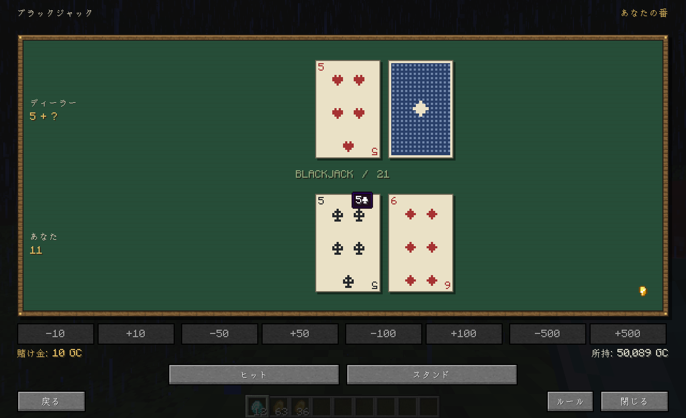
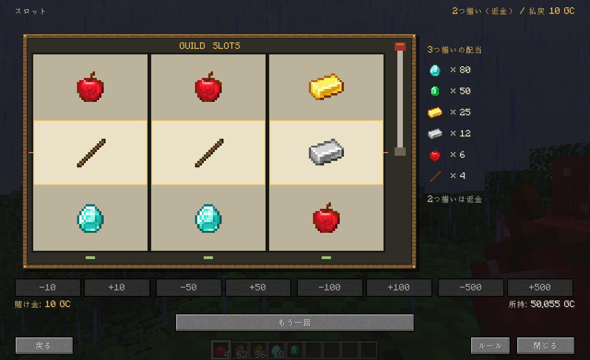

# Fabric / Forge 1.20.1 ボタンGUI

## 対象

main `214a33b5764f01dabc78d191853b5564c8fd0b93`を基準にしています。`feature/gui-buttons`の先端`4c94d60a4c448a19e221bb8ffccfa81b3af81b27`はmainの祖先で、mainが93コミット先行しています。旧ブランチの「サーバーが状態を管理し、ボタンで操作する」「画面を開いてもゲームを停止しない」という方針を現在の全機能へ実装し直しています。mainで廃止された公開クエストの掲示板・依頼発行機能は復活させていません。

## 操作

- `/guild`またはGでギルドを開きます。本日のクエスト、受注中、各種メニュー、ギルド情報をタブで切り替えます。
- 各種メニューから銀行、送金、ギャンブル、ランキング、オークション、管理へ移動します。管理はOPレベル2以上に表示されます。
- 銀行から消費者金融・支払い方法へ、ギャンブルから全6ゲームとGuild FXへ、オークションから出品・自分の出品・受取へ移動します。
- 受注中の「納品・報酬受取」で納品／報酬受取を実行します。「破棄」は確認ボタンをもう一度押すと確定します。
- 賭け金の増減は「増やす」「減らす」の別ボタンです。数字頭は金額の直接入力へ置き換えています。元の加算・消去・全額選択はボタンで使用できます。
- 金額入力は数値の設定です。取引を実行するには入金・出金・送金・出品などのボタンを押します。範囲外の金額は適用できません。
- ページ送りは下部の矢印、マウスホイール、PageUp/PageDownに対応します。サーバーが区切る出品一覧や管理対象一覧にも、従来の前後ページボタンがあります。
- Escで閉じ、「戻る」で親の画面へ移動します。ウィンドウのリサイズやGUIスケール変更でも、選択中のタブと入力中の金額を保持します。

## 実装

17種類の`GuildMenuKind`を各ローダーのMenuTypeとして登録します。通常のチェストは画面名が同じでも置き換えません。`GuildMenuScreen`とゲーム用の`GuildGamblingScreen`は通常の`Screen`と`MenuAccess`を使い、チェスト・インベントリ画面用の他Modの操作ボタンが混ざるのを避けています。

既存ハンドラーのクエスト・支払い・ゲーム・出品・権限確認処理を使用します。表示用ItemStackの名前・説明・操作可否を同期し、GUIのボタンを既存スロットのサーバーアクションへ接続します。チェストの座標はGUIの配置に使用しません。GUI上に実際のインベントリスロットはなく、隠れたスロットのクリックによるアイテム移動も拒否します。

通常の操作はMinecraft標準のコンテナー同期とクリックパケットを使用します。金額入力だけを専用パケットにし、接続、現在のコンテナーID、画面の有効性、権限、金額範囲をサーバー側で確認します。クライアントから料金免除や権限の情報は受け取りません。銀行ブロックの手数料免除はサーバーハンドラーに保持します。

`GuildGuiLayout`が現在のGUI座標系の幅・高さから列数、カード幅、表示行数とページ数を計算します。狭い画面は1列、広い画面は最大3列で、文字は省略表示とツールチップで確認できます。`isPauseScreen()`はfalse、背景はバニラの`renderBackground()`で毎フレーム暗転します。ワールドの画像を固定したり、ゲーム更新を止めたりしません。クエスト・残高・送金先などは約1秒ごとに更新し、ゲームのアニメーションは既存のサーバー更新を使用します。

Fabric・Forgeともに同じ画面・サーバーハンドラーを使用します。ForgeではDeferredRegisterでMenuTypeを登録し、クライアント初期化時に画面を接続します。金額はForgeのSimpleChannelで送信します。Forgeの通信バージョンは3へ更新しており、サーバー・クライアント双方の更新が必要です。Guild FX本体は変更していません。

Forgeではキー設定をMod構築時に登録し、ブロックの描画設定はコンテンツ登録後のFMLClientSetupEventで適用します。登録前にModBlocksを初期化してレジストリー凍結の例外が出るのを防ぎます。

## ギャンブル専用画面

背景の暗転を保ち、6ゲームのプレイ部分を専用描画にしています。木枠にはバニラの板材テクスチャーを使用し、カードのマーク・サイコロ・コイン・馬はピクセル単位で描きます。

- ブラックジャック：緑のテーブルにカードを配り、数字・マーク・絵札・伏せ札・合計を表示します。5枚を超える手札もすべて表示します。
- スロット：3本の縦に回るリール、中央の判定ライン、左からの停止、配当表、クリックできるレバーを表示します。判定は中央の横1列です。
- チンチロ：相手と自分のトレーに、3個ずつのサイコロと実際の出目を描画します。
- コイントス：表裏の選択とコインの回転を表示し、終了時にサーバーが確定した面で止まります。
- ルーレット：0〜36の盤面、赤・黒・ゼロ、回転する球と確定した出目を描画します。
- 競馬：4頭をそれぞれのレーンに描画し、サーバーの進行に合わせて走らせます。馬の選択、倍率、ゴール、勝った馬を表示します。





賭け金は`+10`・`-10`などのボタンで増減します。小さい画面では下部の「賭け金」から設定を開き、競馬では「馬・賭け金」で馬と金額を選べます。Escは設定を開いている場合は設定を閉じ、それ以外はゲーム画面を閉じます。ゲームの開始・ヒット・スタンド・もう一回・戻るなどは、既存ハンドラーのアクションを使用します。

`GamblingLayout`がゲームの描画範囲と下部の操作位置を画面サイズから計算します。リサイズでもプレイ中の状態を保ち、狭い画面では賭け金ボタンを設定画面へ移して、盤面と操作が重ならないようにしています。「ルール」にマウスを合わせると、各ゲームの遊び方と配当を確認できます。

描画に必要な公開情報は、既存のコンテナー同期で`GuildGamblingView`として渡します。伏せ札の数字とマーク、未停止のリールの抽選結果、回転中のルーレットの当選番号、コインの確定面、競馬の予定勝者は公開しません。勝敗・配当・抽選・支払い・途中終了時の精算はクライアントで決めません。

## 検証用Mod

通常の配布JARにテストドライバーは含まれません。隔離したテストワールドでのみ使用してください。

```powershell
./gradlew.bat :common:test :fabric:build :forge:build
./gradlew.bat -PguiDebug :fabric:remapGuiDebugJar :forge:remapGuiDebugJar
```

`gui-debug` JARはテスト用プレイヤーをOPにし、`/guiqa setup`がテストワールド内の資産・出品を初期化します。本番環境には導入しないでください。クライアントを`-Dguildquests.guiQa=true`で起動すると、実際のGUIウィジェットとサーバー通信を使う操作テストが動き、`gui-results.txt`、`gui-status.txt`、`screenshots/`に結果を保存します。

`-Dguildquests.guiQaServer=127.0.0.1:25579`でタイトル画面から通常の接続処理を開始できます。受取専用のクライアントは`-Dguildquests.guiQaControlOnly=true`を使用します。この場合、テスト資産を初期化するシナリオは実行しません。作業ディレクトリーの`gui-control.txt`に`command:コマンド`、`click:ボタン名`、`input:整数`、`shot:画像名`を書くと、次のクライアントtickで実行し、`gui-controls.txt`へ成功した操作を記録します。

Forgeの自動接続がタイムアウトした場合は、マルチプレイの「ダイレクト接続」で参加してください。参加後に操作テストが始まります。
